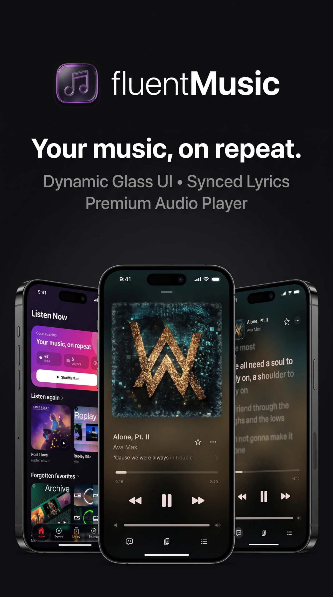

<div align="center">


# FluentMusic

### Your music, on repeat.

**A fast, glassmorphic YouTube Music client for Android.**  
Built with Flutter, real liquid-glass shaders, and an Apple Music-inspired player.

[!\[Latest release](https://img.shields.io/github/v/release/ks3695602-sys/FluentMusic-Flutter?style=for-the-badge&labelColor=0d1117&color=FA2D48)](https://github.com/ks3695602-sys/FluentMusic-Flutter/releases)
[!\[Downloads](https://img.shields.io/github/downloads/ks3695602-sys/FluentMusic-Flutter/total?style=for-the-badge&labelColor=0d1117&color=FA2D48)](https://github.com/ks3695602-sys/FluentMusic-Flutter/releases)
[!\[License](https://img.shields.io/github/license/ks3695602-sys/FluentMusic-Flutter?style=for-the-badge&labelColor=0d1117&color=FA2D48)](LICENSE)
[!\[Flutter](https://img.shields.io/badge/Flutter-3.47.9-02569B?style=for-the-badge&labelColor=0d1117&logo=flutter&logoColor=white)](https://flutter.dev)
[!\[Android](https://img.shields.io/badge/Android-7.0+-3DDC84?style=for-the-badge&labelColor=0d1117&logo=android&logoColor=white)](https://www.android.com)

[**Download**](#download) · [**Features**](#features) · [**Build**](#build-from-source) · [**Credits**](#credits) · [**Disclaimer**](#disclaimer) · [**License**](#license)

<br/>



</div>

> \\\\\\\[!IMPORTANT]
> FluentMusic is an independent, community-built, open-source client. It is \\\\\\\*\\\\\\\*not affiliated with, endorsed by, or connected to YouTube, Google, Spotify, JioSaavn, or any other music service.\\\\\\\*\\\\\\\*

\---

## Why FluentMusic?

Most music players make you choose between a clean interface and a capable one. FluentMusic refuses to pick.

It brings the speed of a native-feeling Flutter player, the visual polish of real shader-based liquid glass, and the kind of lyric experience you normally only get from a first-party app. Search something, tap play, and the artwork, controls and words all move together — with no account required and no unnecessary friction.

* **Fast by default.** A tokenless Zen Music fast path resolves common tracks before the full streaming fallback ladder is needed.
* **Beautiful without being fragile.** Light mode stays readable, dark mode can go true OLED black, and the glass engine can be tuned or turned down.
* **Lyrics that actually keep up.** Word-synced Apple Music-style lyrics, tap-to-seek, timing offset and fourteen configurable providers.
* **Your library, your rules.** Stay fully local, optionally connect YouTube Music, export a backup, or bring your own Supabase keys.
* **Open source, GPL-3.0.** No hidden binary blob for the player. The source is here.

\---

<div align="center">

## Features

<table>
  <tr>
    <td width="50%" valign="top">

#### Playback \& streaming

* **YouTube Music search and streaming** with no account required.
* **Zen Music fast path** — three tokenless native identities answer first for the common case.
* **Full fallback ladder preserved** — BotGuard tokens, TV/WEB\_REMIX clients, loopback proxy and Cobalt last resort.
* **Optional JioSaavn cross-source fallback** when every YouTube identity refuses a track.
* **Low, Medium and High quality** — 96, 160 and 320 kbps.
* **Gapless playback** and **0–12 second crossfade**.
* **In-app equalizer** with bass, virtualizer and frequency bands.
* **Speed \& pitch controls** with live sliders and presets.
* **Sleep timer** and per-track stop options.
* **Background playback** through a proper Android media session.
* **Android Auto** media browser support.
* **Offline downloads** and a smart audio cache for instant replay.
* **Stream diagnostics** showing which client answered and where bytes came from.

</td>
    <td width="50%" valign="top">

#### Player \& lyrics

* **Real liquid-glass UI** — shader refraction, specular highlights and chromatic dispersion.
* **Mornye and Material app styles**, switchable at runtime.
* **Three player backgrounds** — Cinematic, Album Art and Blurred Album Art.
* **Light, dark and system themes** with optional OLED pure black.
* **Glass Lab** for live tuning of distortion, refraction, tint and more.
* **Apple Music-style glowing lyrics** with active-line focus.
* **Word-by-word karaoke tracking** for supported providers.
* **Tap-to-seek lyrics** and ±250 ms timing adjustment.
* **Fourteen configurable lyrics providers** with enable/disable and priority ordering.
* **Encrypted Paxsenix API-key storage** for the three key-gated providers.
* **Readable in light mode** — menus, controls and lyrics follow the active theme.
* **Album-art hero transition** from the mini-player into the full player.

</td>
  </tr>
  <tr>
    <td width="50%" valign="top">

#### Library \& discovery

* **Home shelves** for Quick Picks, Recommended, Listen Again, Speed Dial and Forgotten Favourites.
* **Time Machine** with monthly and yearly listening recaps.
* **Search** with queue playback or related-song playback.
* **Artist pages** with albums, singles, top songs and suggested artists.
* **Radio stations** for lean-back listening.
* **Playlists and folders** with custom covers and descriptions.
* **Liked songs**, offline playlists and playlist sharing.
* **Spotify playlist import** through a CSV export.
* **Listening stats** for top songs, artists and history.
* **Shareable recap cards** for your listening year.

</td>
    <td width="50%" valign="top">

#### Account, sync \& privacy

* **No account required** — the local profile is a first-class experience.
* **Optional YouTube Music sign-in** through Google's own page in an isolated WebView.
* **Library sync** for playlists, liked songs and listening history.
* **Account-powered Home shelves** merged with the local library.
* **Experimental account playback**, off by default and flag-gated, with anonymous fallback.
* **Local JSON export/import** for playlists and liked songs.
* **Full Hive backup and restore** for user data and settings.
* **Optional Supabase cloud sync** using build-time keys — never shipped in the repo.
* **Search history toggle**, pause-on-disconnect and auto-resume controls.
* **Provider attribution** preserved in the lyrics UI and third-party notices.

</td>
  </tr>

</table>

</div>

\---

## A quick tour

<table>
  <tr>
    <td width="33%" valign="top">

#### Listen

A Home feed that feels alive without getting in the way: a cover-driven hero, recently played music, personal shelves and a mini-player that follows you through the app.

&#x20;   </td>

<td width="33%" valign="top">


#### Look

Liquid glass is not a static blur here. It refracts, catches light and reacts to touch. Tune it in Glass Lab, or switch to the cleaner Material style when you want less shimmer.

&#x20;   </td>

<td width="33%" valign="top">


#### Sing

Lyrics are the centrepiece, not a footnote. Active lines glow, supported tracks highlight word by word, and a tap on any line jumps straight to that moment.

&#x20;   </td>

</tr>
</table>

\---

## Under the hood

|Layer|What FluentMusic uses|
|-|-|
|**App**|Flutter 3.47.9 · Dart 3.13 · Riverpod 3|
|**Glass engine**|Vendored and patched `liquid\\\\\\\_glass\\\\\\\_widgets` 1.17.5 with `liquid\\\\\\\_glass\\\\\\\_easy`|
|**Audio**|`just\\\\\\\_audio` · `audio\\\\\\\_service` · `media\\\\\\\_kit` on desktop|
|**Lyrics**|`flutter\\\\\\\_lyric` · TTML and LRC parsers · provider registry with secure key storage|
|**Storage**|Hive · `flutter\\\\\\\_secure\\\\\\\_storage` · path provider|
|**Network**|InnerTube clients · `youtube\\\\\\\_explode\\\\\\\_dart` · loopback range proxy · `flutter\\\\\\\_inappwebview` for BotGuard|
|**Android**|minSdk 24 · targetSdk 36 · Java 17 · compileSdk 36|
|**CI**|GitHub Actions builds the universal APK and a Windows demo, then publishes tagged releases|

\---

<div align="center">

## Download

<a href="https://github.com/ks3695602-sys/FluentMusic-Flutter/releases/latest">
  
</a>

</div>

|Build|What it is|Link|
|-|-|-|
|**Universal APK**|Recommended build for ARM and ARM64 Android phones|[Download APK](https://github.com/ks3695602-sys/FluentMusic-Flutter/releases/latest/download/FluentMusic-universal-release.apk)|
|**Windows demo**|Apple Music-inspired desktop UI demo (x64)|[Download ZIP](https://github.com/ks3695602-sys/FluentMusic-Flutter/releases/latest/download/FluentMusic-AppleMusicDemo-windows-x64.zip)|
|**All releases**|Notes, older versions and every asset|[GitHub Releases](https://github.com/ks3695602-sys/FluentMusic-Flutter/releases)|

**Requirements:** Android 7.0 or newer (API 24+). The Windows package is a desktop demo, not a full replacement for the Android app.

### Install the APK

1. Download `FluentMusic-universal-release.apk` from the latest release.
2. Open the file on your phone.
3. If prompted, allow your browser or file manager to **install unknown apps**.
4. Install and open FluentMusic.

FluentMusic checks GitHub Releases for updates and can show the latest available version from inside the app.

\---

## Configuration

|Settings section|What you can change|
|-|-|
|**Account**|Optional YouTube Music sign-in, sync, local profile, JSON import/export and full backup/restore|
|**Appearance**|Mornye or Material style, system/light/dark theme, OLED pure black, player style and Glass Lab|
|**Playback**|Streaming quality, crossfade, gapless playback, equalizer, stream fallbacks, BotGuard tokens and player background|
|**Lyrics \& Sync**|Glowing lyrics, word tracking, provider order, provider toggles and the Paxsenix API key|
|**FluentMusic Canvas**|Smart cache, clear cache and offline-only mode|
|**Content \& Region**|Language and SponsorBlock integration|
|**Behaviour \& Privacy**|Auto-resume, pause on headphone disconnect and search-history storage|
|**Android Auto**|Expose the media browser service to a car head unit|

### Lyrics providers

FluentMusic ships a configurable provider chain. Enable only what you trust, then reorder providers to decide who gets asked first.

**BetterLyrics · BetterLyrics Portato · YouLy+ · Binimum · LRCLIB · KuGou · Megalobiz · SimpMusic · Unison · Paxsenix Apple Music · Paxsenix Spotify · Paxsenix Musixmatch · YouTube Subtitle · YouTube Music**

The Paxsenix providers are optional and require a key. It is stored with platform secure storage and never committed to the repository. Attribution for Unison and the other providers appears under the lyrics and in [`THIRD\\\\\\\_PARTY\\\\\\\_NOTICES.md`](THIRD_PARTY_NOTICES.md).

### Optional cloud sync

Cloud sync is disabled unless the build is given Supabase credentials:

```bash
flutter run \\\\\\\\
  --dart-define=SUPABASE\\\\\\\_URL=https://your-project.supabase.co \\\\\\\\
  --dart-define=SUPABASE\\\\\\\_ANON\\\\\\\_KEY=your-anon-key
```

Without those values, every local feature still works and the app stays on the local profile. Sync merges by union and does not propagate deletions across devices.

\---

<div align="center">

## Build from source

</div>

### Requirements

* Flutter **3.47.9** stable (or the version pinned in `pubspec.yaml`)
* Dart **3.13+**
* JDK **17**
* Android SDK **36** with build tools installed
* For desktop: the matching Flutter desktop toolchain

### Build the Android APK

```bash
git clone https://github.com/ks3695602-sys/FluentMusic-Flutter.git
cd FluentMusic-Flutter

flutter pub get
flutter test
flutter build apk --release --android-skip-build-dependency-validation
```

The APK is written to:

```text
build/app/outputs/flutter-apk/app-release.apk
```

### Release builds

The workflow at [`.github/workflows/build-apk.yml`](.github/workflows/build-apk.yml) runs analysis and tests, builds the universal APK, builds the Windows demo, and publishes a GitHub Release when a `v\\\\\\\*` tag is pushed:

```bash
git tag -a v1.5.4 -m "FluentMusic v1.5.4"
git push origin v1.5.4
```

A smaller ARM64-only workflow is also available from the Actions tab.

\---

## Project layout

```text
lib/
├── mornye\\\\\\\_player/        # Player stage, lyrics presentation and background modes
├── screens/              # Home, search, library, settings and player screens
├── services/             # Audio, streaming, lyrics, accounts and sync
│   ├── lyrics/           # Provider registry, parsers and secure settings
│   └── streaming/        # Zen resolver and bounded-range proxy
├── widgets/              # Shared glass UI components
└── constants/            # InnerTube client catalog and app constants

packages/                 # Vendored and patched Flutter packages
assets/                   # Icons, fonts, lottie files and BotGuard page
docs/                     # Architecture notes and README artwork
test/                     # Unit and widget tests
```

\---

<div align="center">

## Credits

</div>

FluentMusic is developed by [**jaypakash sahu**](https://github.com/ks3695602-sys).

It would not exist without these projects and communities:

* [**Musify**](https://github.com/gokadzev/Musify) by Valeri Gokadze — the audio core and foundation FluentMusic grew from.
* [**BitChord**](https://github.com/kushagrasinghx/BitChord) by Kushagra Singh — reference for the InnerTube client catalog, BotGuard/PO-token flow and the ArchiveTune lyrics modules.
* [**Mornye**](https://github.com/mornyeapp/Mornye) — reference for the player stage, lyric presentation and multi-client stream ladder.
* [**ZenMusic**](https://github.com/vorlon-dev/Zen-music) — the tokenless stream resolver fast path.
* [**Gyawun Music**](https://github.com/sheikhhaziq/gyawun_music) — reference for the bounded-range retry policy.
* [**liquid\_glass\_widgets**](https://github.com/sdegenaar/liquid_glass_widgets) — the real shader-based liquid-glass toolkit, vendored and patched for FluentMusic.
* [**flutter\_lyric**](https://pub.dev/packages/flutter_lyric), [**just\_audio**](https://pub.dev/packages/just_audio), [**audio\_service**](https://pub.dev/packages/audio_service) and the wider Flutter community.

### Lyrics and metadata

Thanks to [**BetterLyrics**](https://github.com/better-lyrics/better-lyrics), [**YouLy+**](https://github.com/ibratabian17/YouLyPlus), [**Binimum**](https://lyrics-api.binimum.org), [**LRCLIB**](https://lrclib.net), [**SimpMusic**](https://github.com/maxrave-dev/SimpMusic), [**Unison**](https://unison.betterlyrics.org), [**Paxsenix**](https://lyrics.paxsenix.org), [**KuGou**](https://www.kugou.com), [**Megalobiz**](https://www.megalobiz.com) and **YouTube Music** for the lyrics and metadata that make the experience possible.

Lyrics remain the property of their authors and rights holders. FluentMusic only displays them for personal playback and does not redistribute lyric files.

The complete licences, attribution requirements and service notes are in [`THIRD\\\\\\\_PARTY\\\\\\\_NOTICES.md`](THIRD_PARTY_NOTICES.md).

\---

<div align="center">

## Contributing

</div>

Contributions are welcome — bug reports, provider fixes, accessibility improvements, tests and documentation are all useful.

1. Read [`CONTRIBUTING.md`](CONTRIBUTING.md) and [`CODE\\\\\\\_OF\\\\\\\_CONDUCT.md`](CODE_OF_CONDUCT.md).
2. Fork the repository and create a focused branch.
3. Make the change and add or update tests where it makes sense.
4. Run the checks before opening a pull request:

```bash
flutter analyze --no-fatal-infos --no-fatal-warnings
flutter test
```

5. Open a pull request explaining the problem, the change and how you tested it.

For playback bugs, include your app version, Android version, device model and any relevant details from **Settings → Playback → Stream Diagnostics**. Please do not paste cookies, API keys or other private account data into an issue.

\---

<div align="center">

## Support

</div>

The best support is a clear issue report or a pull request. If FluentMusic has earned a place in your rotation, star the repository and share it with someone who still types song names into a search box.

[**Report a bug**](https://github.com/ks3695602-sys/FluentMusic-Flutter/issues) · [**Request a feature**](https://github.com/ks3695602-sys/FluentMusic-Flutter/issues) · [**View releases**](https://github.com/ks3695602-sys/FluentMusic-Flutter/releases)

\---

<div align="center">

## Disclaimer \& legal notice

</div>

FluentMusic is an independent, community-driven third-party audio player. It is **not associated with Google LLC, YouTube, YouTube Music, Spotify, JioSaavn, or any of their parent companies**.

* **No media hosting.** FluentMusic does not host, upload or store copyrighted music files. It acts as an interface to public, public-facing or user-authenticated APIs, and to media the user already has access to.
* **Personal use.** The project is intended for personal research, education and fair use. You are responsible for ensuring that your usage complies with your local copyright laws and the terms of service of the sources you access.
* **Unofficial endpoints.** Fallback bridges, cross-source search and lyrics providers are third-party services. They can change, rate-limit or disappear at any time. FluentMusic does not guarantee availability.
* **Account playback is experimental.** YouTube's BotGuard/PO-token requirements can cause signed-in playback to fall back to the anonymous stream. That fallback is expected, not an error.
* **Copyleft.** FluentMusic is free software under GPLv3. The licence does not let anyone forbid others from selling or redistributing copies, but any distribution must include the corresponding source under the same licence.

\---

<div align="center">

## License

</div>

FluentMusic is licensed under the **GNU General Public License v3.0 (GPLv3)**.

See [`LICENSE`](LICENSE) for the full text. If you distribute a modified build, you must make the corresponding source available under the same licence.

<br/>

<div align="center">

<sub>Built with Flutter. Designed for the joy of listening.</sub>

<br/><br/>

<a href="https://github.com/ks3695602-sys/FluentMusic-Flutter">
  
</a>

</div>

